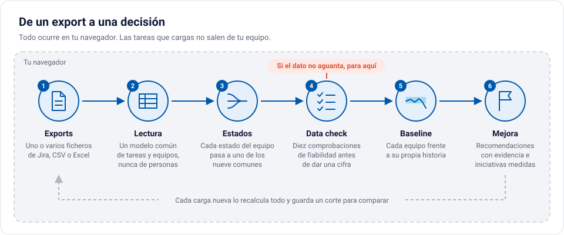
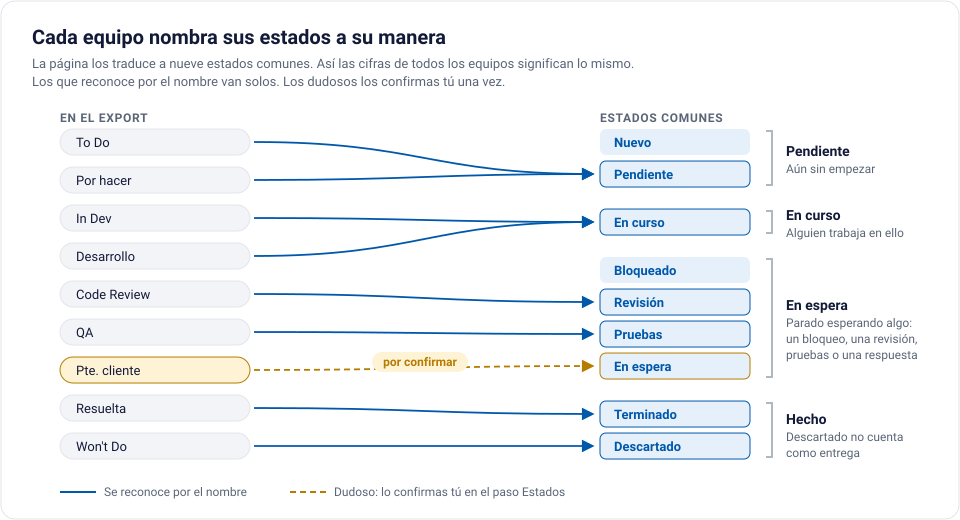
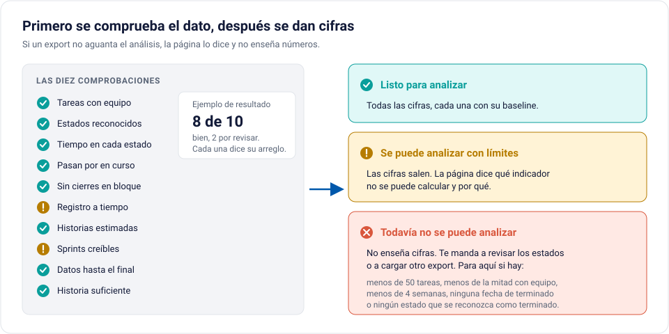
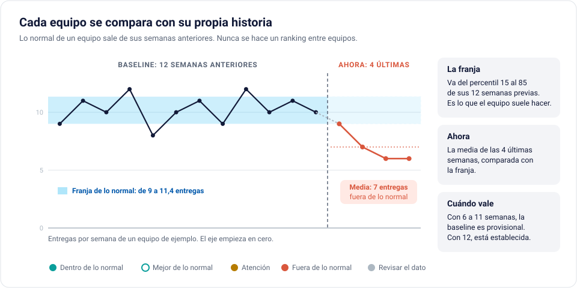
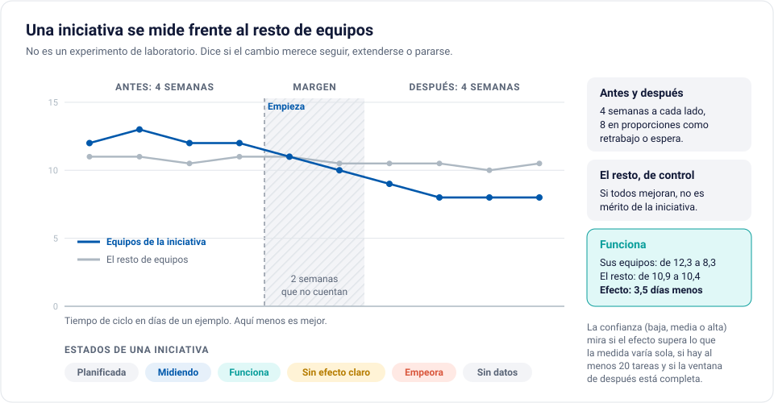
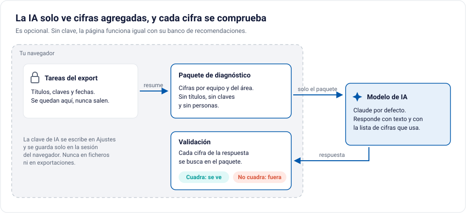

# Easy Performance

Herramienta para medir equipos de desarrollo a partir de sus exports. Comprueba si el dato es fiable, compara cada equipo con su propia historia y propone mejoras con la evidencia al lado. Interfaz en castellano e inglés.

**Abrir la aplicación:** https://alvar-zamorano-work.github.io/Easy-performance/

**Presentación del producto:** https://alvar-zamorano-work.github.io/Easy-performance/landing/ (en inglés: https://alvar-zamorano-work.github.io/Easy-performance/landing/en/)

Hoy la página lee exports de Jira, en CSV o en Excel. Azure DevOps ya tiene adaptador en el núcleo, pero todavía no está en la página. GitLab está pendiente.

## Cómo funciona



La página hace seis cosas, siempre en este orden. Todo ocurre en tu navegador: no hay servidor y las tareas que cargas no salen de tu equipo. Cada vez que cargas exports nuevos, lo recalcula todo y guarda un corte para comparar con la carga anterior.

### 1. Lee los exports y entiende los estados



Sueltas uno o varios exports. La página los junta y los pasa a un modelo común de tareas y equipos. Ese modelo no tiene campos de personas: no hay asignado ni autor en ninguna pantalla.

Cada equipo llama a sus estados de una forma ("In Dev", "Desarrollo", "Code Review"). La página los traduce a nueve estados comunes, agrupados en pendiente, en curso, en espera y hecho. Los que reconoce por el nombre van solos. Los dudosos los confirmas tú una vez, en el paso Estados. Sin este paso, el tiempo de ciclo o el tiempo en espera de dos equipos no se podrían comparar.

### 2. Comprueba el dato antes de dar cifras



Antes de enseñar un número, la página mira si el export aguanta el análisis. Hace diez comprobaciones de fiabilidad. Por ejemplo: si las tareas tienen equipo, si se registran a tiempo o si hay cierres masivos de un día. Cada comprobación dice cómo se arregla.

El resultado es uno de tres veredictos:

- **Listo para analizar.** Salen todas las cifras.
- **Se puede analizar con límites.** Salen las cifras, y la página dice qué indicador no se puede calcular y por qué.
- **Todavía no se puede analizar.** No sale ninguna cifra. Pasa con menos de 50 tareas, menos de la mitad con equipo, menos de 4 semanas de datos, sin fecha de terminado o sin ningún estado que se reconozca como terminado.

### 3. Compara cada equipo con su propia historia



Esta es la idea central. Cada equipo tiene su baseline: la franja de lo que suele hacer. Va del percentil 15 al 85 de sus 12 semanas anteriores. Lo de ahora (la media de las 4 últimas semanas) se compara con esa franja.

- Con 6 a 11 semanas de historia, la baseline es provisional. Con 12, está establecida.
- Un equipo nunca se compara en bruto con otro. No hay ranking.
- En las entregas, si lo normal era cero o el valor triplica la franja, la página no lo da por bueno: lo marca como "Revisar el dato". Suele ser una limpieza del tablero o un cambio en cómo se registra el trabajo.

Qué indicadores se ven depende de lo que quieras mejorar. Lo eliges al empezar:

| Si quieres mejorar | Se mide |
|---|---|
| Velocidad | Tiempo de ciclo y entregas por semana |
| Calidad | Retrabajo y bugs nuevos por semana |
| Previsibilidad | Tareas que pasan de un sprint al siguiente (no con flujo continuo) |
| Coste | Coste por tarea terminada (necesita el coste de cada equipo) |
| Preparar para IA | Tickets bien descritos para que los haga un agente |

### 4. Propone qué hacer y mide si funciona



Cuando un indicador se sale de lo normal, la página propone qué hacer. Cada recomendación sale de un banco de casos y lleva la cifra que la dispara, sus causas probables, preguntas para el equipo y un plan.

De una recomendación puedes crear una iniciativa: un cambio concreto, en unos equipos, para mover una medida. La página la sigue sola en cada carga:

1. Toma las 4 semanas de antes (8 en proporciones como retrabajo).
2. Deja 2 semanas de margen, porque un cambio tarda en notarse.
3. Mide las semanas de después.
4. Compara el cambio en sus equipos con el cambio en el resto. Si todos mejoran a la vez, no es mérito de la iniciativa.

El resultado es un estado (funciona, sin efecto claro, empeora...) con una confianza baja, media o alta.

### 5. La IA, si la quieres



El asistente de IA es opcional. Sin clave, todo funciona igual con el banco de casos.

Con clave, la IA propone recomendaciones, lee el impacto de las iniciativas y responde preguntas. Solo recibe el paquete de diagnóstico: cifras por equipo y del área, sin títulos, sin claves de ticket y sin personas. Cada cifra que devuelve se busca en ese paquete. Si una no cuadra, la respuesta no se enseña.

La clave se escribe en Ajustes y se guarda solo en la sesión del navegador. Nunca va a ficheros ni a exportaciones.

### Para quién es cada vista

Al empezar eliges para quién es la vista. Se cambia cuando quieras.

| Vista | Qué ve primero |
|---|---|
| Dirección | Estado general, dónde hay un problema con evidencia y qué decidir |
| PMO | Fiabilidad del dato, qué arreglar en la captura y qué comparaciones son válidas |
| Equipo | Su flujo frente a su baseline y qué hacer esta semana, sin compararse con nadie |

## Cómo se usa

- Abre la aplicación. Puedes cargar tus exports o explorar con un banco de ejemplo ficticio.
- La primera vez, la página te guía: datos, revisión, estados, qué quieres mejorar, data check y para quién es la vista.
- Desde ahí, el menú lateral lleva al análisis (Resumen, Equipos, Baseline, Calidad del dato, Recomendaciones, Iniciativas y Cortes) y a la configuración (Fuentes y mapeo, y Ajustes).

## Desarrollo

Requisitos: Node 22.18 o posterior. Para el recorrido en el navegador, Chrome o Chromium (o su ruta en la variable `CHROME`).

```bash
npm ci
npm run comprobar          # tipos y tests
npm run verificar-web-v3   # construye la página y la recorre en Chromium
```

`npm run web-v3` genera la página en `dist/EasyPerformance-v3/EasyPerformance.html`.

## Publicación

Cada cambio que entra en `main` se comprueba y se publica solo en GitHub Pages (`.github/workflows/pages.yml`). Los PR pasan las mismas comprobaciones, sin publicar.

## Datos

En el repositorio solo hay datos sintéticos y exports de prueba que no son de cliente. Los datos reales nunca entran aquí.

El detalle técnico del núcleo, los adaptadores y el catálogo está en `LEEME.md` y en `docs/contrato-v3.md`. Las ilustraciones de este README están en `docs/img/` y son SVG editables a mano.
